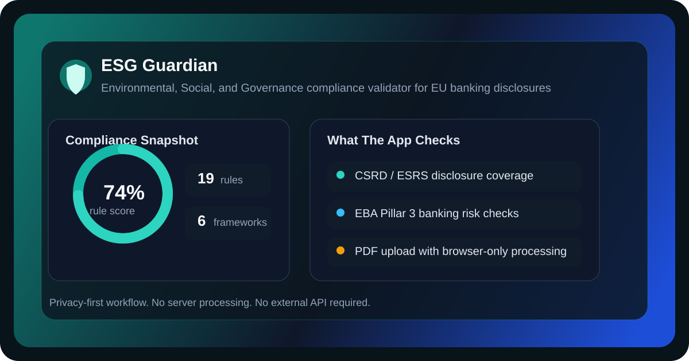
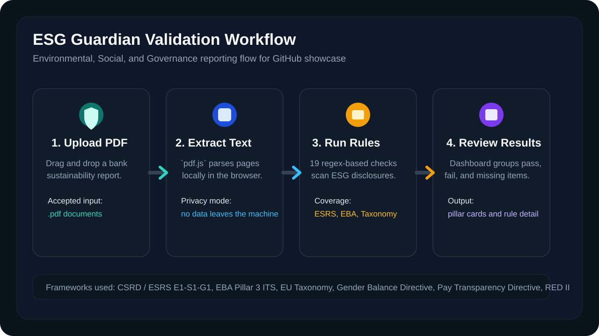

# ESG Guardian (Environmental, Social, and Governance)


Client-side ESG compliance validation for EU banking sustainability reports. The app extracts text from uploaded PDFs, evaluates disclosure and threshold-based rules, and presents a clean dashboard for Environmental, Social, and Governance review.



## Overview

ESG Guardian (Environmental, Social, and Governance) helps showcase and validate how a sustainability report aligns with major EU disclosure frameworks used in banking. It is designed as a browser-first experience with no backend dependency.

- Runs entirely in the browser using `pdfjs-dist`
- Applies 19 rule checks across ESG pillars
- Covers 6 legal and regulatory frameworks
- Highlights pass, fail, and missing disclosures
- Surfaces rule detail, extracted snippets, and legal sources

## Demo Example

The seeded demo state in the UI uses `Banco_BPM_Sustainability_Report_2024.pdf` as the example report.

- Example report: `Banco_BPM_Sustainability_Report_2024.pdf`
- Official source page: [Banco BPM Group Sustainability Reporting](https://gruppo.bancobpm.it/sustainability/non-financial-reports/)
- UI note: the app now highlights this example report and links directly to the official Banco BPM sustainability reporting page

## Key Features

- PDF upload with instant local processing
- Compliance score and summary statistics
- Pillar breakdown for Environmental, Social, and Governance
- Detailed rule table with traceable legal references
- Legal framework explorer for CSRD / ESRS, EBA Pillar 3, and related directives
- Privacy-first workflow with no server-side document handling

## Framework Coverage

- `ESRS E1 / S1 / G1`
- `EBA Pillar 3 ITS`
- `EU Taxonomy Regulation`
- `EU Gender Balance Directive`
- `EU Pay Transparency Directive`
- `EU Renewable Energy Directive (RED II)`

## Validation Flow



## Tech Stack

- `React 18`
- `TypeScript`
- `Vite`
- `Tailwind CSS`
- `shadcn/ui`
- `TanStack Query`
- `React Router`
- `pdfjs-dist`

## Getting Started

### Prerequisites

- `Node.js 18+`
- `npm`

### Install

```bash
npm install
```

### Start The App

```bash
npm run dev
```

### Build For Production

```bash
npm run build
```

### Run Tests

```bash
npm run test
```

## Project Structure

```text
.
|-- public/
|-- src/
|   |-- components/
|   |-- data/
|   |-- hooks/
|   |-- lib/
|   |-- pages/
|   `-- types/
|-- index.html
|-- package.json
`-- vite.config.ts
```
## Academic Context

This project aligns with the topic:

`MSc ETAA - University of Parma (2025-2026) - AI-Driven ESG Accountability under CSRD for Italian Regional Banks`
