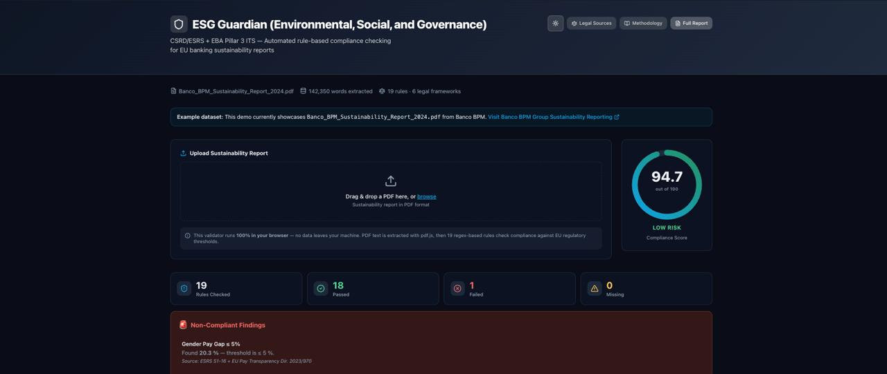
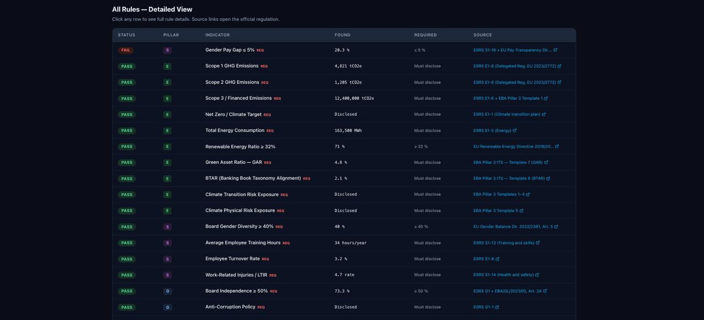
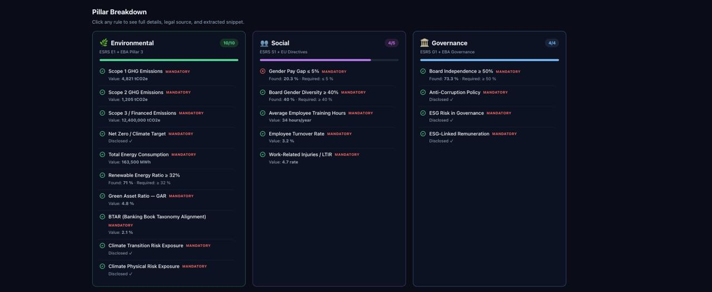

# ESG Guardian (Environmental, Social, and Governance)


Client-side ESG compliance validation for EU banking sustainability reports. The app extracts text from uploaded PDFs, evaluates disclosure and threshold-based rules, and presents a clean dashboard for Environmental, Social, and Governance review.


## Application Screenshots

The following screenshots are taken from the deployed ESG Guardian experience and complement the existing preview and workflow images.

| Dashboard Overview | Findings And Metrics | Rule Validation View |
| --- | --- | --- |
|  |  |  |

**Screenshot Highlights**

- `screenshot1.jpg`: top-level dashboard with the Banco BPM example dataset, upload area, score gauge, and summary statistics
- `screenshot2.jpg`: findings panels and pillar breakdown with pass/fail visibility in the live UI
- `screenshot3.jpg`: detailed rules validation table and methodology-driven compliance review flow

## Overview

ESG Guardian (Environmental, Social, and Governance) helps showcase and validate how a sustainability report aligns with major EU disclosure frameworks used in banking. It is designed as a browser-first experience with no backend dependency.

- Runs entirely in the browser using `pdfjs-dist`
- Applies 19 rule checks across ESG pillars
- Covers 6 legal and regulatory frameworks
- Highlights pass, fail, and missing disclosures
- Surfaces rule detail, extracted snippets, and legal sources

## Live Demo

The project is deployed and publicly accessible, with the seeded UI currently showcasing the Banco BPM 2024 sustainability reporting example.

- Live website: [ESG Guardian Demo](https://papaya-bublanina-0721f3.netlify.app)
- Example report used in the live demo: `Banco_BPM_Sustainability_Report_2024.pdf`
- Official source page: [Banco BPM Group Sustainability Reporting](https://gruppo.bancobpm.it/sustainability/non-financial-reports/)
- In-app note: the interface explicitly highlights the Banco BPM example dataset and links users to the official reporting page

## Key Features

- PDF upload with instant local processing
- Compliance score and summary statistics
- Pillar breakdown for Environmental, Social, and Governance
- Detailed rule table with traceable legal references
- Legal framework explorer for CSRD / ESRS, EBA Pillar 3, and related directives
- Privacy-first workflow with no server-side document handling

## Framework Coverage

- `ESRS E1 / S1 / G1`
- `EBA Pillar 3 ITS`
- `EU Taxonomy Regulation`
- `EU Gender Balance Directive`
- `EU Pay Transparency Directive`
- `EU Renewable Energy Directive (RED II)`

## Validation Flow


## Next Steps

The next step for ESG Guardian is to add a **second validation layer** on the **server side** using a **self-hosted LLM**.

Right now, the app works fully in the browser:

- it extracts text from the PDF locally
- it checks the report using clear rules, regex patterns, and thresholds
- it shows results that are easy to trace back to the legal source

This works well for structured checks, but some ESG disclosures are written in a more narrative way. In those cases, a simple rule may miss the meaning even if the report is actually saying the right thing.

That is why the next version will add a second layer that helps read the report in a more contextual way.

### What This Second Layer Will Do

- review selected parts of the report on the server side
- use a self-hosted model instead of an external API
- support the current rule-based results, not replace them
- help understand qualitative disclosures that are harder to catch with regex alone
- provide clearer explanations when a disclosure looks complete, incomplete, or uncertain
- flag unclear cases for manual review

### Why It Matters

- it can improve checks for narrative ESG sections
- it can reduce missed disclosures when companies use different wording
- it can create a stronger hybrid approach: rule-based validation plus semantic review
- it keeps the project moving toward a more realistic compliance support tool

### Planned Validation Flow

- **Step 1**: client-side PDF extraction and rule-based validation
- **Step 2**: server-side review with a self-hosted LLM
- **Step 3**: combined results with evidence, explanations, and conflict checks

In simple terms, the goal is to keep the current system transparent and traceable, while adding a smarter second pass for the parts that need more context.

## Tech Stack

- `React 18`
- `TypeScript`
- `Vite`
- `Tailwind CSS`
- `shadcn/ui`
- `TanStack Query`
- `React Router`
- `pdfjs-dist`

## Getting Started

### Prerequisites

- `Node.js 18+`
- `npm`

### Install

```bash
npm install
```

### Start The App

```bash
npm run dev
```

### Build For Production

```bash
npm run build
```

### Run Tests

```bash
npm run test
```

## Project Structure

```text
.
|-- public/
|-- src/
|   |-- components/
|   |-- data/
|   |-- hooks/
|   |-- lib/
|   |-- pages/
|   `-- types/
|-- index.html
|-- package.json
`-- vite.config.ts
```
## Academic Context

This project aligns with the topic:

`MSc ETAA - University of Parma (2025-2026) - AI-Driven ESG Accountability under CSRD for Italian Regional Banks`
